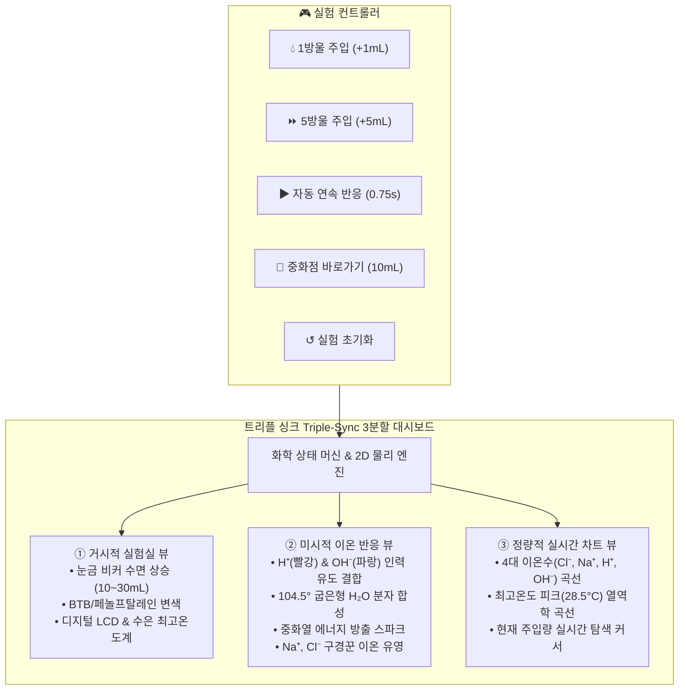

# 🧪 중화 반응 가상 실험실 (Neutralization Reaction Virtual Lab)

> **2022 개정 교육과정 중학교 3학년 과학 & 고등학교 통합과학 맞춤형 인터랙티브 가상 실험실**  
> 산성 용액(묽은 염산, $HCl$)과 염기성 용액(수산화나트륨 수용액, $NaOH$)의 중화 반응을 **미시적(이온 결합) · 거시적(비커/지시약/온도) · 정량적(실시간 그래프)** 3분할 뷰로 1:1 실시간 동기화하여 시각화합니다.

[](https://wbmaker2.github.io/neutralization-reaction-simulator/)
[](LICENSE)
[](tests/)
[](index.html)

---

## 🌐 실시간 체험 링크 (Live Demo)

별도 프로그램 설치나 로그인 없이 웹 브라우저에서 바로 실험을 조작해 볼 수 있습니다:

👉 **[중화 반응 가상 실험실 웹앱 바로가기](https://wbmaker2.github.io/neutralization-reaction-simulator/)**

*(PC, 태블릿, 모바일 및 학교 전자칠판 터치스크린 완벽 대응)*

---

## 🎯 개발 배경 및 교육적 해결 과제

중화 반응 단원에서 학생들은 실제 실험 관찰과 분자 수준의 미시적 원리 사이에서 다음과 같은 **대표적인 오개념**을 겪습니다:

1. **오개념 1: 구경꾼 이온의 침전 오해**  
   * *"중화 반응이 끝나면 $NaCl$ 소금 앙금이 물속에 가라앉는다?"*  
   * ➔ **해결:** 물속에 완전히 해리되어 반응하지 않고 자유롭게 유영하는 구경꾼 이온($Na^+$, $Cl^-$)의 실제 이온 상태를 캔버스로 명확히 보여줍니다.
2. **오개념 2: 중화점 이후의 온도 변화 착각**  
   * *"염기성 용액을 계속 넣으면 열이 계속 발생하여 온도가 끝없이 올라간다?"*  
   * ➔ **해결:** 중화점($10\text{mL}$)에서 물($H_2O$)이 최대로 생성되어 최고 온도($28.5^\circ\text{C}$)를 기록한 후, 차가운 실온 용액 희석에 의해 온도가 서서히 내려가는 실제 열역학 곡선을 실시간 트래킹합니다.
3. **오개념 3: 지시약 변색과 이온 수의 상관관계 모호성**  
   * ➔ **해결:** 비커 수용액의 BTB(노랑 ➔ 초록 ➔ 파랑) 변색과 수소 이온($H^+$), 수산화 이온($OH^-$)의 실시간 소멸/축적 수치를 1:1로 실시간 대조합니다.

---

## 🔬 핵심 시각화 및 주요 기능 (트리플 싱크)



### 1. 거시적 실험실 뷰 (비커 & 지시약)
- **스포이트/뷰렛 액적 투하 애니메이션**: $NaOH$ 수용액 액적이 비커로 떨어지며 수면 파동 생성.
- **수면 높이 및 눈금 연동**: $10\text{mL} \rightarrow 30\text{mL}$ 수면 상승 및 $10\text{mL}, 20\text{mL}, 30\text{mL}, 40\text{mL}$ 눈금 표시.
- **지시약 선택 기능**:
  - **BTB 용액**: 산성(노랑) $\rightarrow$ 중성(선명한 초록) $\rightarrow$ 염기성(파랑).
  - **페놀프탈레인 용액**: 산성/중성(무색투명) $\rightarrow$ 염기성(붉은 자주색).
- **정밀 디지털 & 수은 온도계**: 비커 속 온도계에 수은 기둥 승강 및 디지털 LCD 창($20.0^\circ\text{C} \sim 28.5^\circ\text{C}$) 동시 표기.

### 2. 미시적 이온 반응 뷰 (2D Canvas 돋보기 확대경)
- **자연스러운 브라운 열운동 (Brownian Motion)**: 수용액 경계 안에서 부드럽게 튀는 탄성 충돌 물리.
- **정전기적 상호 인력 결합**: 미반응 $H^+$와 $OH^-$가 근접($75\text{px}$) 시 서로를 향해 가속 인력 작용 ➔ 접촉 즉시 물 분자($H_2O$)로 합성.
- **실제 화학 분자 구조 반영**: 산소($O$)와 수소($H$) 2개가 **$104.5^\circ$ 굽은형 구조**로 결합된 물 분자 모형 회전 렌더링.
- **중화열 에너지 방출 스파크**: 결합 순간 반짝이는 파티클 버스트 연출.
- **학습 편의 옵션**: `[알짜 이온만 강조]`(구경꾼 이온 반투명화), `[물 분자 표시 토글]`, `[배속 조절 (0.5x, 1x, 2x)]`.

### 3. 정량적 실시간 차트 & 통계 패널
- **4대 이온 수 변화 곡선**:
  - $Cl^-$ (초록색): 10개 일정 (구경꾼 이온)
  - $Na^+$ (보라색): $0 \rightarrow 20$개 정비례 증가 (구경꾼 이온)
  - $H^+$ (빨간색): 10개에서 0개로 감소하여 $10\text{mL}$ 중화점에서 완전 소멸 (알짜 이온)
  - $OH^-$ (파란색): $10\text{mL}$까지 0개 유지 후 초과 주입 시 증가 (알짜 이온)
  - 총 이온 수 (점선): $20$개 유지 후 $10\text{mL}$ 이후 증가
- **온도 변화 곡선 ($T-V$ Curve)**:
  - 초기 $20.0^\circ\text{C}$ $\rightarrow$ 중화점($10\text{mL}$)에서 **최고 온도 $28.5^\circ\text{C}$** 달성 ➔ 실온 용액 냉각 곡선 추적.
- **현재 주입량 수직 탐색선(Cursor Line)** 실시간 이동 및 '★ 중화점 (10mL)' 기준선 마커 제공.

### 4. 무설치 순수 Web Audio API 사운드 신디사이저
- 외부 mp3/wav 파일 다운로드 없이 브라우저 내장 오디오 오실레이터로 효과음 즉시 합성:
  - 💧 **물방울 소리**: 800Hz ➔ 300Hz Sine 주파수 스윕.
  - ⚡ **중화 반응 결합음**: 520Hz ➔ 1100Hz Triangle 에너지 스파크음.
  - 🎺 **중화점 도달 팡파레**: C5 - E5 - G5 - C6 4음 아르페지오 축하 사운드.
  - 🔔 **골든벨 정답(딩동댕) & 오답(버저)** 피드백 효과음.

### 5. 3단계 교육용 탭 구성
- **🧪 가상 실험실**: 트리플 싱크 메인 시뮬레이터.
- **📖 핵심 개념 탐구**: 산·염기 이온화, 중화 반응 화학식, 알짜/구경꾼 이온 비교, 실생활 속 중화 반응 4선(제산제, 생선 레몬즙, 벌 쏘임 처치, 산성 토양 석회 가루).
- **🏆 형성평가 골든벨**: 2022 개정 교육과정 기출 핵심 3문항 퀴즈, 선택 시 즉각적인 피드백 및 100점 달성 시 Canvas 축하 폭죽(Confetti) 연출.

---

## 💻 기술 스택 및 아키텍처

| 구분 | 적용 기술 | 특징 |
|---|---|---|
| **Core Architecture** | Pure Vanilla JavaScript (ES6+) | 외부 빌드 도구 및 npm 런타임 의존성 제로 (Zero-Setup) |
| **Styling** | Tailwind CSS (CDN) | 다크 사이언스 랩 글래스모피즘 UI, 전자칠판 대응 대형 터치 버튼 |
| **Graphics** | HTML5 2D Canvas API | 고해상도 그래픽, 파티클 물리 엔진, 실시간 차트 렌더러 |
| **Audio** | Web Audio API | 순수 프로시저럴 오실레이터 음향 합성 (네트워크 오프라인 구동 보장) |
| **Testing** | Node.js Native Test Runner (`node:test`) | 58개 단위/통합 테스트 전 항목 자동화 검증 |
| **Deployment** | GitHub Pages & GitHub Actions | `main` 브랜치 자동 배포 (`HTTP 200 OK`) |

---

## 📁 프로젝트 디렉토리 구조

```
neutralization-reaction-simulator/
├── index.html                   # 단일 무설치 Standalone 웹앱 (탐색기 더블클릭 실행 가능)
├── package.json                 # 프로젝트 메타데이터 및 ES 모듈 설정
├── src/
│   └── js/
│       ├── chemistry.js         # 화학 반응 상태 머신 & 열역학/지시약 계산 엔진
│       ├── audio-effects.js     # Web Audio API 오실레이터 사운드 신디사이저
│       ├── particle-engine.js   # 2D Canvas 이온 물리 & 브라운 운동 & 분자 결합 시뮬레이션
│       ├── chart-renderer.js    # 거시적 비커 뷰 & 실시간 이온수/온도 곡선 렌더러
│       ├── concept-data.js      # 2022 개정 교육과정 핵심 개념 데이터
│       ├── quiz-data.js         # 형성평가 3문항 퀴즈 및 Canvas 축하 폭죽 모듈
│       └── app.js               # UI 컨트롤러 및 전체 컴포넌트 오케스트레이터
├── tests/
│   ├── chemistry.test.js        # 화학 상태 머신 단위 테스트 (5 tests)
│   ├── audio-effects.test.js    # 사운드 엔진 단위 테스트 (10 tests)
│   ├── particle-engine.test.js  # 이온 물리 엔진 단위 테스트 (17 tests)
│   ├── chart-renderer.test.js   # 비커 및 차트 렌더러 단위 테스트 (13 tests)
│   ├── quiz-concept.test.js     # 퀴즈 및 개념 데이터 단위 테스트 (7 tests)
│   └── integration.test.js      # 단일 파일 아키텍처 통합 테스트 (6 tests)
└── docs/
    └── superpowers/
        ├── specs/               # 상세 설계 명세서 (Design Spec)
        └── plans/               # 세부 구현 계획서 (Implementation Plan)
```

---

## 🏃 로컬 실행 및 테스트 방법

### 1. 브라우저에서 바로 실행 (무설치)
인터넷 연결이나 Node.js 설치 없이도 Windows 탐색기에서 [`index.html`](index.html) 파일을 더블클릭하면 즉시 실행됩니다:
```bash
# 또는 브라우저 명령어로 직접 열기
start index.html
```

### 2. 전체 단위 및 통합 테스트 실행
Node.js(v18 이상 권장, Node 24 완벽 호환) 내장 테스트 러너를 사용하여 외부 패키지 설치 없이 58개 전체 테스트를 0.2초 만에 검증할 수 있습니다:
```bash
node --test tests/*.test.js
```

**테스트 실행 결과:**
```
ℹ tests 58
ℹ suites 14
ℹ pass 58
ℹ fail 0
ℹ cancelled 0
ℹ skipped 0
ℹ todo 0
```

---

## 📜 라이선스

This project is licensed under the **MIT License** - 자세한 내용은 [LICENSE](LICENSE) 파일을 참조하세요.
