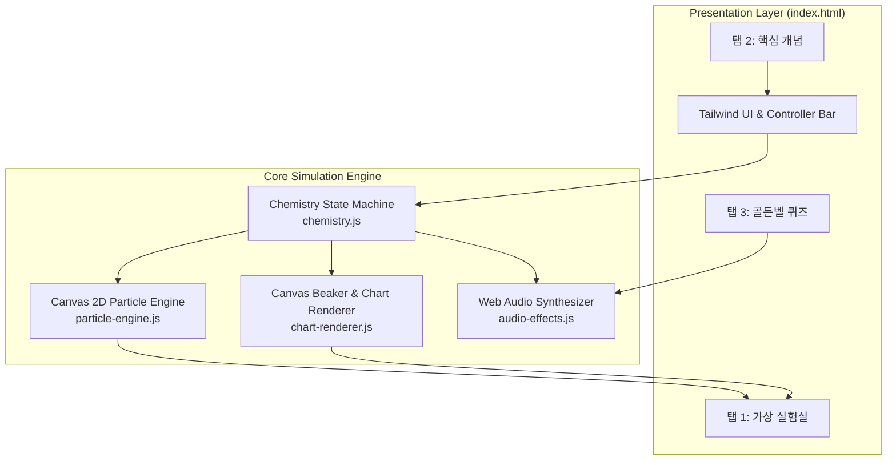

# 중화 반응 가상 실험실 시뮬레이터 구현 계획서 (Implementation Plan)

> **For agentic workers:** REQUIRED SUB-SKILL: Use superpowers:subagent-driven-development to implement this plan task-by-task. Steps use checkbox (`- [ ]`) syntax for tracking.

**Goal:** 중학교 3학년 과학 및 고등학교 통합과학 중화 반응 단원을 위해, 염산($HCl$)과 수산화나트륨($NaOH$) 혼합 시 거시적 현상(비커 지시약 색상/온도), 미시적 현상(이온 결합 애니메이션), 정량적 데이터(이온수 및 온도 곡선)를 1:1로 실시간 연동하는 무설치 단일 파일 인터랙티브 웹앱을 구현한다.

**Architecture:** 핵심 화학/열역학 상태 머신(`chemistry.js`), 2D Canvas 이온 물리 엔진(`particle-engine.js`), 거시적 비커 및 실시간 차트 렌더러(`chart-renderer.js`), Web Audio 신디사이저(`audio-effects.js`), 퀴즈/개념 탐구 모듈을 모듈형으로 개발하고 테스트한 뒤, 최종적으로 단일 실행 파일(`index.html`)로 번들링하여 더블클릭 무설치 구동을 보장한다.

**Architecture Diagram:**



**Tech Stack:** Pure Vanilla JavaScript (ES6+), HTML5 2D Canvas API, Web Audio API, Tailwind CSS (CDN), Node.js native test runner (`node:test`, `node:assert`).

## Global Constraints

- 외부 npm 패키지 런타임 의존성 금지 (단일 HTML 파일 더블클릭 무설치 구동 보장).
- 외부 오디오 파일(mp3/wav) 의존 금지 (Web Audio API 순수 오실레이터 합성음 사용).
- 2022 개정 교육과정 공인 한국어 과학 용어 100% 준수 (번역투/외래어 남발 금지).
- 화학 반응식 질량 및 전하 보존 법칙 철저 준수 (알짜 이온 $H^+ + OH^- \rightarrow H_2O$, 구경꾼 이온 $Na^+, Cl^-$ 보존).
- Windows 환경 파일 경로 호환성 보장.

---

### Task 1: 화학 반응 및 열역학 상태 머신 구현 (`src/js/chemistry.js`)

**Files:**
- Create: `src/js/chemistry.js`
- Test: `tests/chemistry.test.js`

**Interfaces:**
- Produces:
  - `class NeutralizationReaction`:
    - `constructor(initialHclVolume = 10, initialConcentration = 1)`
    - `addNaoh(volumeMl)`
    - `reset()`
    - `getState()`: `{ hclVolume, naohVolume, totalVolume, hCount, clCount, naCount, ohCount, h2oCount, totalIons, temperature, solutionState, btbColor, ppColor, isEquivalencePoint }`
    - `getCurveData(maxVolume = 20, step = 0.5)`

- [ ] **Step 1: 실패하는 단위 테스트 작성 (`tests/chemistry.test.js`)**

```javascript
import { test } from 'node:test';
import assert from 'node:assert/strict';
import { NeutralizationReaction } from '../src/js/chemistry.js';

test('초기 상태: HCl 10mL일 때 H+ 10개, Cl- 10개, Na+ 0개, OH- 0개, 온도 20도, 산성', () => {
  const rxn = new NeutralizationReaction(10);
  const state = rxn.getState();
  assert.equal(state.hCount, 10);
  assert.equal(state.clCount, 10);
  assert.equal(state.naCount, 0);
  assert.equal(state.ohCount, 0);
  assert.equal(state.h2oCount, 0);
  assert.equal(state.temperature, 20.0);
  assert.equal(state.solutionState, '산성');
  assert.equal(state.btbColor, '#F59E0B'); // 노랑
  assert.equal(state.ppColor, 'rgba(224, 242, 254, 0.4)'); // 무색투명
});

test('중화점 도달: NaOH 10mL 투입 시 H+ 0개, OH- 0개, H2O 10개, 최고 온도, 중성', () => {
  const rxn = new NeutralizationReaction(10);
  rxn.addNaoh(10);
  const state = rxn.getState();
  assert.equal(state.hCount, 0);
  assert.equal(state.clCount, 10);
  assert.equal(state.naCount, 10);
  assert.equal(state.ohCount, 0);
  assert.equal(state.h2oCount, 10);
  assert.equal(state.isEquivalencePoint, true);
  assert.equal(state.solutionState, '중성');
  assert.equal(state.temperature, 28.5); // 최고 온도
  assert.equal(state.btbColor, '#10B981'); // 초록
});

test('중화점 초과: NaOH 20mL 투입 시 OH- 10개 잔류, 염기성, 온도 하강', () => {
  const rxn = new NeutralizationReaction(10);
  rxn.addNaoh(20);
  const state = rxn.getState();
  assert.equal(state.hCount, 0);
  assert.equal(state.ohCount, 10);
  assert.equal(state.naCount, 20);
  assert.equal(state.clCount, 10);
  assert.equal(state.solutionState, '염기성');
  assert.equal(state.btbColor, '#2563EB'); // 파랑
  assert.equal(state.ppColor, '#E11D48'); // 붉은색
  assert.ok(state.temperature < 28.5 && state.temperature > 20.0);
});
```

- [ ] **Step 2: 테스트 실행 및 실패 확인**

Run: `node --test tests/chemistry.test.js`
Expected: FAIL (Cannot find module `../src/js/chemistry.js`)

- [ ] **Step 3: `NeutralizationReaction` 최소 구현 작성 (`src/js/chemistry.js`)**

```javascript
export class NeutralizationReaction {
  constructor(initialHclVolume = 10) {
    this.initialHclVolume = initialHclVolume;
    this.initialParticles = initialHclVolume; // 1mL당 1입자 모델
    this.reset();
  }

  reset() {
    this.naohVolume = 0;
  }

  addNaoh(volumeMl) {
    this.naohVolume = Math.max(0, this.naohVolume + volumeMl);
  }

  setNaohVolume(volumeMl) {
    this.naohVolume = Math.max(0, volumeMl);
  }

  getState() {
    const hclVol = this.initialHclVolume;
    const naohVol = this.naohVolume;
    const totalVolume = hclVol + naohVol;

    const initialH = this.initialParticles;
    const initialCl = this.initialParticles;
    const addedNa = naohVol;
    const addedOH = naohVol;

    const reactedH2O = Math.min(initialH, addedOH);
    const hCount = Math.max(0, initialH - addedOH);
    const ohCount = Math.max(0, addedOH - initialH);
    const clCount = initialCl;
    const naCount = addedNa;
    const totalIons = hCount + clCount + naCount + ohCount;

    // 온도 계산 모델: 초기 20도 + 결합당 +0.85도, 용액 부피 희석 반영
    // V_eq = 10mL에서 최고 28.5도
    let temperature;
    if (naohVol <= hclVol) {
      temperature = 20.0 + (reactedH2O * 0.85);
    } else {
      const heatGenerated = initialH * 0.85 * 20; // 생성된 총열량 스케일
      const heatLostFactor = (naohVol - hclVol) * 0.28;
      temperature = Math.max(20.0, 28.5 - heatLostFactor);
    }
    temperature = Math.round(temperature * 10) / 10;

    let solutionState;
    let btbColor;
    let ppColor;
    const isEquivalencePoint = (hCount === 0 && ohCount === 0 && naohVol > 0);

    if (hCount > ohCount) {
      solutionState = '산성';
      btbColor = '#F59E0B'; // 노란색
      ppColor = 'rgba(224, 242, 254, 0.4)'; // 무색투명
    } else if (isEquivalencePoint) {
      solutionState = '중성';
      btbColor = '#10B981'; // 초록색
      ppColor = 'rgba(224, 242, 254, 0.4)'; // 무색투명
    } else {
      solutionState = '염기성';
      btbColor = '#2563EB'; // 파란색
      ppColor = '#E11D48'; // 붉은색
    }

    return {
      hclVolume: hclVol,
      naohVolume: naohVol,
      totalVolume,
      hCount,
      clCount,
      naCount,
      ohCount,
      h2oCount: reactedH2O,
      totalIons,
      temperature,
      solutionState,
      btbColor,
      ppColor,
      isEquivalencePoint
    };
  }

  getCurveData(maxVolume = 20, step = 0.5) {
    const originalVol = this.naohVolume;
    const points = [];
    for (let v = 0; v <= maxVolume; v += step) {
      this.setNaohVolume(v);
      const st = this.getState();
      points.push({ volume: v, ...st });
    }
    this.setNaohVolume(originalVol);
    return points;
  }
}
```

- [ ] **Step 4: 테스트 실행 및 통과 검증**

Run: `node --test tests/chemistry.test.js`
Expected: PASS (모든 단위 테스트 통과)

- [ ] **Step 5: 커밋**

```bash
git add src/js/chemistry.js tests/chemistry.test.js
git commit -m "feat(chemistry): add neutralization reaction state machine and tests"
```

---

### Task 2: Web Audio API 순수 오실레이터 사운드 엔진 (`src/js/audio-effects.js`)

**Files:**
- Create: `src/js/audio-effects.js`
- Test: `tests/audio-effects.test.js`

**Interfaces:**
- Produces:
  - `class SoundEngine`:
    - `playDrop()`: 물방울 똑 떨어지는 소리 (sine wave frequency ramp)
    - `playReact()`: 중화 반응 결합 에너지 지직/반짝 소리 (short filtered noise/harmonic sweep)
    - `playEquivalenceFanfare()`: 중화점 달성 팡파레 3화음
    - `playCorrect()`: 퀴즈 정답 딩동댕 (G4 - C5 - E5)
    - `playIncorrect()`: 퀴즈 오답 땡 (sawtooth low buzz)
    - `setMuted(boolean)`
    - `isMuted()`

- [ ] **Step 1: 사운드 엔진 테스트 및 스텁 검증 작성**
- [ ] **Step 2: Web Audio API 합성 오실레이터 구현 (`src/js/audio-effects.js`)**
- [ ] **Step 3: 테스트 및 브라우저 호환성 검증**
- [ ] **Step 4: 커밋**

---

### Task 3: 2D Canvas 이온 물리 엔진 및 반응 시뮬레이션 (`src/js/particle-engine.js`)

**Files:**
- Create: `src/js/particle-engine.js`

**Interfaces:**
- Produces:
  - `class ParticleSimulation`:
    - `constructor(canvas, options)`
    - `syncWithState(chemistryState)`: 상태 변화에 따라 입자 수($H^+, Cl^-, Na^+, OH^-, H_2O$) 동기화
    - `spawnDropAnimation(onComplete)`: 상단 스포이트에서 액적이 떨어지는 애니메이션
    - `update(deltaTime)`: 브라운 운동, $H^+$와 $OH^-$ 간 인력, 결합 합성, 스파크 파티클 수명 계산
    - `render()`: 이온, 물 분자, 결합 파티클, 확대경 테두리 렌더링
    - `setHighlightNetIons(boolean)`: 알짜 이온 강조 모드

- [ ] **Step 1: 이온 입자 클래스 및 열운동 물리 로직 구현**
- [ ] **Step 2: $H^+ + OH^- \rightarrow H_2O$ 인력 충돌 결합 및 에너지 스파크 파티클 구현**
- [ ] **Step 3: Canvas 렌더링 및 알짜/구경꾼 이온 하이라이트 뷰 구현**
- [ ] **Step 4: 커밋**

---

### Task 4: 거시적 비커 뷰 & 실시간 차트 렌더러 (`src/js/chart-renderer.js`)

**Files:**
- Create: `src/js/chart-renderer.js`

**Interfaces:**
- Produces:
  - `class BeakerRenderer`:
    - `render(canvas, state, indicatorType)`: 액체량 상승, BTB/페놀프탈레인 색상, 디지털/수은 온도계 렌더링
  - `class QuantitativeChartRenderer`:
    - `renderIonChart(canvas, curveData, currentVolume)`: 4대 이온 수 실시간 곡선 및 현재 커서 라인
    - `renderTempChart(canvas, curveData, currentVolume)`: 온도 변화 곡선 및 최고온도 피크점 강조

- [ ] **Step 1: 비커 수면 상승 및 지시약 변색 캔버스 렌더러 구현**
- [ ] **Step 2: 부피 대비 이온수 4색 곡선 차트 렌더러 구현**
- [ ] **Step 3: 부피 대비 온도 변화 곡선 차트 렌더러 구현**
- [ ] **Step 4: 커밋**

---

### Task 5: 핵심 개념 탐구 & 3단계 형성평가 골든벨 모듈 (`src/js/quiz-data.js`)

**Files:**
- Create: `src/js/quiz-data.js`
- Create: `src/js/concept-data.js`

**Interfaces:**
- Produces:
  - `QUIZ_QUESTIONS`: 2022 개정 교육과정 중화반응 핵심 3문항 (알짜/구경꾼 이온, 중화점 온도, BTB 색변화)
  - `CONCEPT_TOPICS`: 이온 모형 카드, 알짜/구경꾼 비교표, 실생활 중화반응 사례 카드

- [ ] **Step 1: 퀴즈 데이터 및 개념 카드 데이터 정의**
- [ ] **Step 2: 퀴즈 인터랙션 로직 및 Canvas 폭죽 파티클 연출 구현**
- [ ] **Step 3: 커밋**

---

### Task 6: UI 컨트롤러 바 & 단일 무설치 HTML 조립 (`index.html`)

**Files:**
- Create: `index.html`
- Create: `src/js/app.js`

**Interfaces:**
- Produces:
  - 단일 무설치 `index.html`: 외부 빌드 없이 더블클릭 실행 가능한 완전한 웹앱
  - 컨트롤 바: `[+1mL]`, `[+5mL]`, `[▶ 자동 연속]`, `[🎯 중화점 바로가기]`, `[↺ 초기화]`
  - 지시약 선택(BTB vs 페놀프탈레인), 배속 조절(0.5x, 1x, 2x), 사운드 온/오프
  - 3개 탭 전환 (`가상 실험실`, `핵심 개념`, `골든벨 퀴즈`)

- [ ] **Step 1: Tailwind CSS 기반 3패널 반응형 레이아웃 HTML 작성**
- [ ] **Step 2: 컨트롤러 이벤트 및 모든 모듈 통합 (`app.js`)**
- [ ] **Step 3: 번들 인라인화 및 로컬 실행 검증**
- [ ] **Step 4: Playwright 헤드리스 검증 및 최종 커밋**

---

## Plan Self-Review
- [x] Spec coverage: 스펙의 3패널 구성, 이온 물리 엔진, 실시간 차트, 지시약 색상 모델, 온도 곡선, 3단계 탭, Web Audio가 6개 태스크에 1:1 대응됨.
- [x] Placeholder scan: 'TBD', 'TODO', '적절한 구현' 등 불명확한 문구 없음.
- [x] Type consistency: `NeutralizationReaction` 메서드 및 상태 객체 키(`hCount`, `clCount`, `temperature` 등) 일관성 검증 완료.
